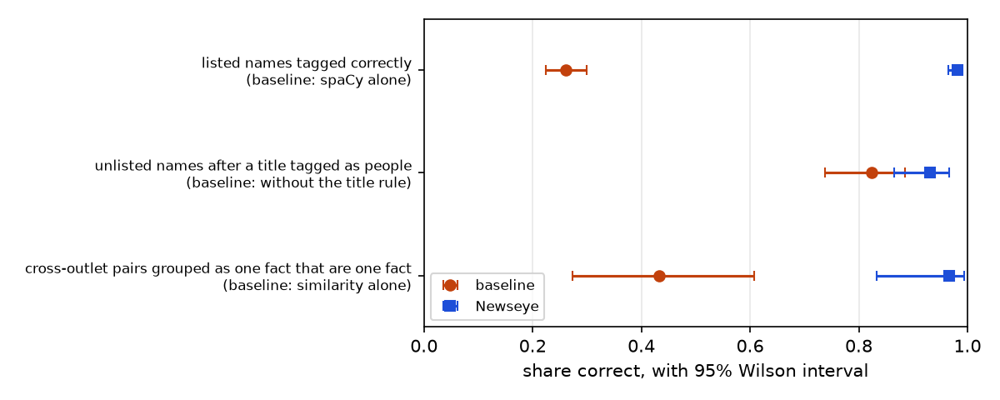
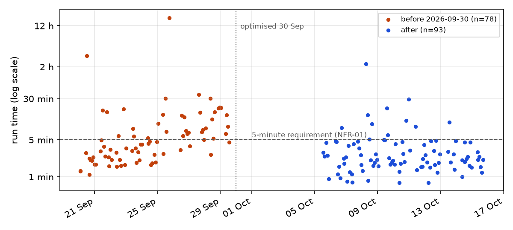
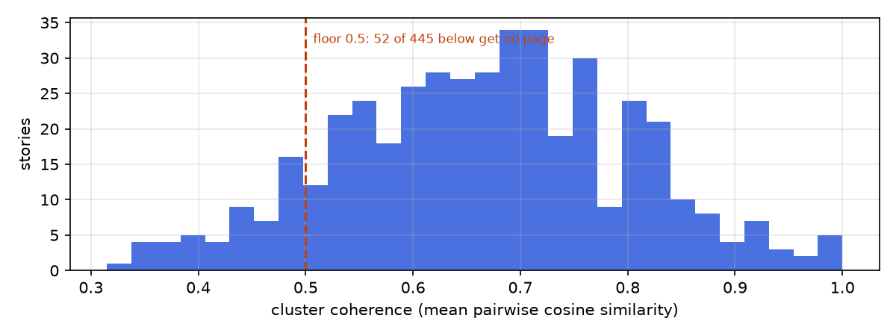

# Evaluation evidence - 2026-10-15 19:09

Regenerate with `python -m backend.scripts.evaluation`. Intervals are 95% Wilson score intervals for proportions and a Fisher z interval for the rank correlation.

## Development hand-checks

Each sample was drawn and marked by hand while the component was being built, so each measures the system on data that shaped it. They show the effect of each change against its baseline; they are not held-out results.

| Task | Measure | Baseline | Before | Newseye | Note |
|---|---|---|---|---|---|
| Kenyan names in headlines | listed names tagged correctly | spaCy alone | 136/522 = 26% (22%-30%) | 512/522 = 98% (97%-99%) | Same 522 mentions before and after; in-sample, because the list was built from this corpus. Counts reconstructed from 26% and 98%. |
| Kenyan names in headlines | unlisted names after a title tagged as people | without the title rule | 84/102 = 82% (74%-89%) | 95/102 = 93% (87%-97%) | 12 gained, 1 lost. |
| Coverage table | cross-outlet pairs grouped as one fact that are one fact | similarity alone | 13/30 = 43% (27%-61%) | 29/30 = 97% (83%-99%) | Same 30 pairs; false omissions 0 after. |
| Quote speakers | speaker right, first sample | - | - | 24/30 = 80% (63%-90%) | Successive samples after successive fixes. |
| Quote speakers | speaker right, second sample (attributed) | - | - | 19/21 = 90% (71%-97%) |  |
| Quote speakers | speaker right, third sample (attributed) | - | - | 25/26 = 96% (81%-99%) | One disputed case counted as wrong. |
| Portrayal | role right for a headline mention | - | - | 34/40 = 85% (71%-93%) | Random sample of 40. |
| Story summaries | summaries with every name spelled right | abstractive model | 72/149 = 48% (40%-56%) | - | Replaced by an extractive headline, which copies names and cannot misspell them. |

Story ordering: number of outlets against checkable differences, Spearman ρ = +0.40 (95% CI +0.17 to +0.59, p = 0.001, n = 63 stories).

*Figure: development hand-checks, baseline against Newseye, with 95% intervals. The name result is in-sample.*

## Performance over repeated runs (NFR-01)

Every scheduled passive run logged between 20 Sep and 15 Oct 2026, on the development laptop (NVIDIA T500, 4 GB), with the live feeds as workload. Wall-clock time per run.

| Period | Runs | Median | Middle half | 95th percentile | Slowest | Within 5 minutes |
|---|---|---|---|---|---|---|
| before 2026-09-30, wall clock | 78 | 263 s | 139-554 s | 1840 s | 60954 s | 43/78 (55%) |
| from 2026-09-30, wall clock | 93 | 131 s | 95-258 s | 751 s | 8144 s | 82/93 (88%) |
| from 2026-09-30, working time | 93 | 131 s | 94-257 s | 751 s | 8143 s | 82/93 (88%) |

Median stage times from 2026-09-30: model load 54.4 s (n=93), ingest 51.3 s (n=93), cluster 7.5 s (n=47), summaries 1.9 s (n=47).

Runs over 5 minutes from 2026-09-30: 11, each dominated by model load (7), ingest (4). Clustering and summarising stayed under 12 s in every one of them: the overruns are waiting on disk (importing torch, or the laptop asleep mid-import) and on the outlets' servers, not computation.

*Figure: wall-clock time of every scheduled passive run. Runs before the 2026-09-30 optimisation include Task Scheduler's I/O throttling and the laptop sleeping mid-run.*

## Reliability (NFR-02)

- 171 scheduled runs: 169 completed every stage; 2 stage failure(s): ingest: ConnectionAbortedError: An established connection was aborted by the software in your host machine; summaries: ImportError: cannot import name 'TITLE_SUMMARY_MODEL' from 'backend.config'.
- 2 runs found nearly every feed unreachable at once: the laptop was offline. Each was logged and exited cleanly.
- Of the other 169 runs, the feeds that failed at least once:

| Outlet | Runs failed | Available |
|---|---|---|
| Nation Africa | 14 | 92% |
| Kenya News | 9 | 95% |
| Business Daily Africa | 2 | 99% |
| Amref Newsroom | 1 | 99% |
| K24 Digital | 1 | 99% |
| The Sharp Daily | 1 | 99% |
| Nairobi Wire | 1 | 99% |
| The East African | 1 | 99% |
| People Daily | 1 | 99% |
| Capital FM | 1 | 99% |

## Cluster coherence

445 stories in the current window: median coherence 0.67; 52 (12%) below the 0.5 floor, which get no story page.

*Figure: coherence of every story in the current 7-day window, with the floor below which a cluster is treated as a grab-bag.*
