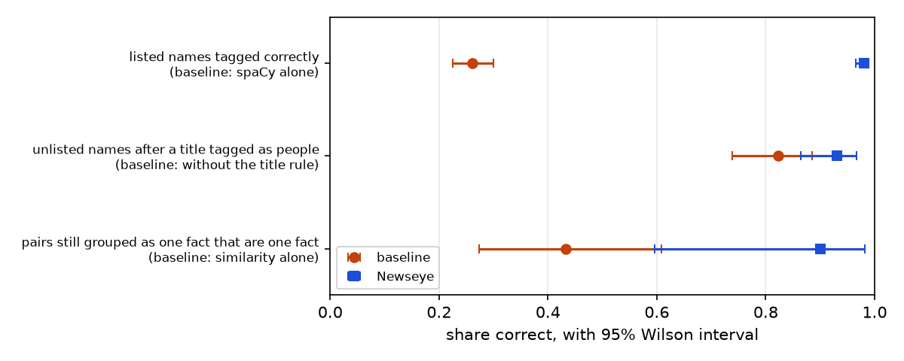
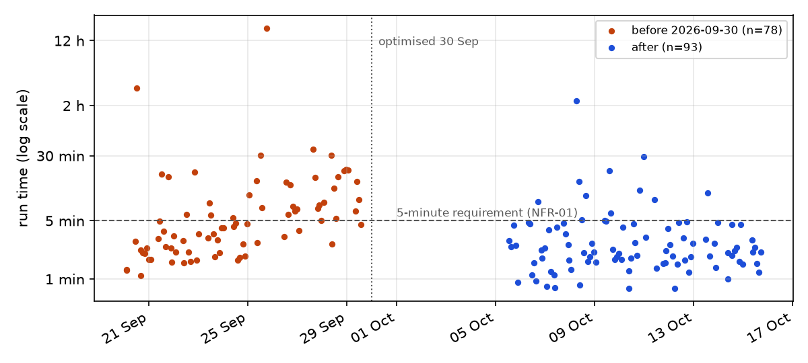
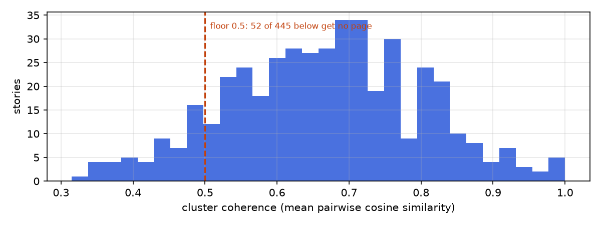

# Newseye: testing and evaluation

This document is source material for Chapter 5 (sections 5.4 and 5.5). Every
number in it comes from a record in `docs/evidence/`, and every record can be
regenerated with the command named beside it. Table and figure numbers follow
the report's Chapter 5 numbering. Renumber them if your chapter differs. Updated
6 November 2026. Items marked **To confirm** need the author's answer before they
go in the report.

| Record | Command | Latest |
|---|---|---|
| Automated test cases | `python -m backend.scripts.test_record` | [test-record-2026-11-08](evidence/test-record-2026-11-08.md) |
| System test, feeds to site | `python -m backend.scripts.end_to_end` | [end-to-end-2026-10-27](evidence/end-to-end-2026-10-27.md) |
| Evaluation: intervals, repeated runs, figures | `python -m backend.scripts.evaluation` | [evaluation-2026-10-15](evidence/evaluation-2026-10-15.md) |
| Held-out evaluation | `python -m backend.scripts.heldout sample`, then `score` | [heldout-results-2026-10-19](evidence/heldout-results-2026-10-19.md); sheets in [evidence/heldout/](evidence/heldout/). **Quotes: 8 of 40 labelled** |
| Quote speakers, AI-assisted check | Method in the record | [quotes-ai-check-2026-10-19](evidence/quotes-ai-check-2026-10-19.md) |
| One story with NewsMTSC, timed | Method in the record | [active-tier-timing-2026-10-19](evidence/active-tier-timing-2026-10-19.md) |
| Framing, NewsMTSC benchmark | `python -m backend.eval.benchmark_framing` | [benchmark](../eval/framing/benchmark.md) |
| Framing, Kenyan labels | `python -m backend.eval.score_framing agree`, then `report` | [report](../eval/framing/report.md), [agreement](../eval/framing/agreement.json), [labels](../eval/framing/gold.csv). **Error causes not yet filled in** |
| Fact pairs | Development sample recovered; `python -m backend.scripts.fact_pairs sample`, then `score` for the fresh one | [fact-pairs/](evidence/fact-pairs/README.md), [fact-pairs-results-2026-11-09](evidence/fact-pairs-results-2026-11-09.md). **Fresh sheet: 30 of 30 marked by the developer, 9 Nov** |
| Fine-tuning | `python -m backend.eval.finetune_framing pool`, then `build`, `train`, `compare` | [compare-r1](../eval/framing/finetune/compare-r1.md): published weights kept |
| Web API against the real database | `python -m backend.scripts.test_api --live` | 18 checks on 9 Nov, all passed, on the real database and on its test copy. They print to the console and are not stored; the other 63 cases are in the test record |
| Usability test | Protocol in [usability-test-plan.md](usability-test-plan.md) | **Not yet run** |

---

## 5.4.1 Test strategy and acceptance criteria

**Purpose.** The tests show whether Newseye meets its requirements (Table 5.1).
Its main objective is to let a reader see what each Kenyan outlet reported
about one event, without the system issuing any verdict.

**Scope.**

- **In scope:** the whole pipeline (ingestion, clustering, the active-tier
  analysis and the static site), its failure behaviour, and the read-only web
  API built for the planned React interface.
- **Out of scope:** the outlets' own websites, the internal accuracy of the
  pretrained models (they are tested only as used here), and load beyond one
  machine. The public site is static files, with no server, login or
  database, so authentication and server-side injection tests do not apply to
  it. The API has no logins yet and is not deployed, so login and access tests
  wait until it does.

**Responsibilities.**

- The developer designed and ran every test, and labels the held-out sample.
  The names task was meant to be blind; Section 5.4.3 says where it was not.
- The developer marked the fresh fact-pair sheet, which does not show what NLI
  decided. Claude did not see the marks before they were scored.
- A second annotator labelled the Kenyan framing sample without seeing the
  developer's labels.
- Claude, an AI assistant, judged the development checks of fact pairs, quote
  speakers and portrayal roles, and the separate quote check. It also reviewed the
  developer's held-out names and roles and first framing labels against the rules.
  Each is reported as AI-assisted where it appears.
- The supervisor reviews the records.
- 5 to 8 volunteers take the usability test.

**Table 5.1: Requirements the tests trace to.** The same IDs are in
`backend/scripts/testkit.py` and in every record. Align them with Chapter 3 if
the numbering there differs.

| ID | Requirement |
|---|---|
| FR-01 | Collect articles from the RSS feeds of 12 Kenyan outlets, de-duplicated, each with an embedding and a topic |
| FR-02 | Group articles reporting the same event into stories that keep their id as news arrives |
| FR-03 | Recognise Kenyan people, institutions and places |
| FR-04 | Show which outlets carried each fact, which said something related, and which could not be read |
| FR-05 | Show who was quoted and how each outlet's version of a remark differs |
| FR-06 | Show each outlet's figures, side by side only when they count the same thing |
| FR-07 | Show how each outlet presents a named person |
| FR-08 | Point the reader to the stories where outlets differ most |
| FR-09 | Publish a static site (dashboard, story, people and search pages) that can also be sent as one file |
| FR-10 | Search the collection by meaning |
| NFR-01 | Performance: a passive run within 5 minutes; one story analysed within 30 s |
| NFR-02 | Reliability: a failing feed, database or clustering is reported and never damages stored stories |
| NFR-03 | Security: third-party feed content cannot inject markup or script; no credentials in the repository |
| NFR-04 | Neutrality: no verdicts or scores; an outlet that could not be read is never counted as leaving anything out |

**Table 5.2: Test levels and techniques.**

| Level | Question it answers | How | Technique |
|---|---|---|---|
| Unit | Does each component produce the right output? | 8 suites, 119 cases (TC-CL to TC-DV, without TC-TS) | Black-box: realistic sentences in the forms outlets use, many of them real failures kept as regression cases. White-box for cluster continuity: one case per branch of the matching rule. |
| Unit and integration, edges | Do thresholds, failures and hostile input behave as documented? | `test_robustness`, 19 cases (TC-RB) | Grey-box: boundary values taken from the code's thresholds; failures injected by replacing a known dependency (database, feed, clustering input) with one that fails |
| Integration | Do components agree at their interfaces? | Coverage suite (MiniLM + NLI + set arithmetic); CI job that builds the schema from an empty pgvector database; the system test's checks at each hand-off; the web API through FastAPI's test client against a fake data layer, 63 cases (TC-AP), plus 17 checks against the real database; the React interface's pages and components against a fake API, 65 cases (TC-UI) | Black-box |
| System | Does the whole pipeline work on live data? | `end_to_end`: feeds to database to clusters to analysis to site, 23 checks (ST); the React interface in Edge against the real API, 8 flows (E2E) | Black-box, live workload |
| Performance and reliability | Is it fast and dependable enough over time? | 171 scheduled runs (20 Sep to 15 Oct); 18 held-out stories timed | Repeated measurement |
| Security | Can feed content attack a reader? Are secrets exposed? Can the API be misused? | TC-RB-09 to -11; review of SQL construction; scan of the git history; TC-AP: bad input refused before the database, rate limits, failures that reveal nothing, a database account that can only read | Negative testing plus manual review |
| Model evaluation | How accurate are the NLP components? | Development checks against baselines; a held-out sample; an AI-assisted quote check; the NewsMTSC benchmark; 300 Kenyan mentions labelled by two annotators | Labelled samples, Wilson intervals, McNemar test, Cohen's kappa, paired bootstrap |
| Acceptance and usability | Can intended readers use it as meant? | Task-based test with SUS | Planned, not yet run |

**Case types.**

- **Positive:** the cases that must group, tag or attribute.
- **Negative:** pairs that must stay apart (TC-FG-08 to -14, TC-CS-10 to -15),
  names that must not become people (TC-EN-19 to -22), and headlines that must
  not read as speech (TC-PT-16, -17).
- **Boundary:** TC-RB-01 to -05, -17, -18, and TC-AP's limits on input.
- **Exception:** TC-RB-06 to -08, -19.
- **Empty input:** TC-RB-12 to -16.

**Table 5.3: Test environment.**

| Item | Value |
|---|---|
| Machine | Development laptop, Windows 11 Pro, NVIDIA T500 (4 GB) |
| Runtime | Python 3.13.7, torch 2.12.0+cu130 |
| Database | PostgreSQL 18.4, pgvector 0.8.2 |
| NLP | spaCy 3.8.16 with `en_core_web_sm` 3.8.0; transformers 5.17.0; sentence-transformers 6.0.1; hdbscan 0.8.44 |
| Models | `all-MiniLM-L6-v2`, `deberta-v3-base-zeroshot-v1.1-all-33` (topic and NLI), `twitter-roberta-base-sentiment-latest`; GRU-TSC through NewsSentiment 1.2.28, in its own Python 3.11 worker |
| Tools | ruff 0.16.8; scipy 1.18.1 and matplotlib 3.11.1 for the evaluation; FastAPI 0.161.0 and its test client for the API; GitHub Actions (ubuntu-latest, Python 3.13, CPU torch) |

**Test data.**

- **Unit cases:** written by hand in the forms Kenyan outlets use.
- **System and performance tests:** the live feeds.
- **Held-out sample:** articles ingested after the code freeze.
- **Kenyan framing sample:** 300 mentions drawn by turns across outlets and
  fields, split into dev and test by item, so 9 articles have items in both.

All of it is published news: headlines, short quotes and public figures named
in reporting. Article bodies are fetched only for analysis and never stored.

**Table 5.4: Acceptance criteria, fixed before measurement.** The date each
was fixed matters, because a threshold chosen after seeing the result proves
nothing.

| Criterion | Threshold | Fixed |
|---|---|---|
| Automated regression cases | 100% pass; 0 lint findings | With the suites; enforced by CI |
| System test | Every hand-off check passes | 15 Oct 2026, before its first run |
| One story analysed (NFR-01) | ≤ 30 s | 15 Oct, before the 18 held-out stories were timed |
| Passive run (NFR-01) | ≤ 300 s | 15 Oct. The 171 logged runs predate it, so they are reported against it but were not run to meet it |
| Held-out quote speakers | ≥ 90% correct | 15 Oct, before any labelling |
| Held-out portrayal roles | ≥ 80% correct | 15 Oct, before any labelling |
| Held-out name tagging | ≥ 90% of headlines fully correct, and better than spaCy alone | 15 Oct, before any labelling |
| Usability | ≥ 80% task success; ≥ 80% comprehension; SUS mean ≥ 68 | 15 Oct, before any session |
| Agreement on the Kenyan framing labels | Cohen's kappa of about 0.6 or more, or the annotation guide is revised | With the guide, before any labelling |
| Using fine-tuned weights | Better than the published weights on Kenyan test people, with the paired 95% interval above zero, and no more than 0.03 lost on either NewsMTSC test set | Before any tuned model was scored |

---

## 5.4.2 Test cases, defects and retesting

There are 219 automated cases in 11 Python suites, and all 219 pass, with 1 known
limitation recorded and not counted. The React interface (`frontend/`) adds 65
component and page cases (TC-UI, `npm test`) and 8 end-to-end flows in Edge
against the real API (E2E, `npm run e2e`), all passing on 8 November 2026. Table 5.5 summarises them by module in the
template's format. Each case's own scenario, expected result and actual result
is in the [test record](evidence/test-record-2026-11-08.md).

**Table 5.5: Test cases and results.**

| Test ID | Traceability | Scenario, data and conditions | Expected result | Actual result, evidence and verdict |
|---|---|---|---|---|
| TC-CL-01 to -10 | FR-02 | Stored and new cluster memberships: identical, grown, aged out, split, merged, a stray article, empty history | Each new cluster inherits the right old id, or a fresh one; no id handed to two clusters | 10/10 as expected; test record. **Pass** |
| TC-EN-01 to -22 | FR-03 | 21 sentences with Kenyan names, titles, namesakes, places and ambiguous words; the entity list itself | Each name found with the right type and identity; nothing invented; no alias naming two people | 22/22; test record. **Pass** |
| TC-CV-01 to -06 | FR-04, NFR-04 | Real cross-outlet sentence pairs that Claude checked, including an unreadable outlet | Each outlet marked reported, related, omitted or not applicable, as Claude marked them | 6/6; test record. **Pass** |
| TC-QT-01 to -21 | FR-05 | 15 attribution forms, a continued quote, 5 cross-outlet alignments | Right speaker and attribution type; versions compared as same, says less or reworded | 21/21; test record. **Pass** |
| TC-FG-01 to -16 | FR-06 | 7 figure pairs that must group, 7 that must not, 1 known limitation; a figure in a sentence using the pronoun "who" (TC-FG-16) | Grouped or kept apart as listed; a figure is never credited to the pronoun | 15/15 counted; the known limitation (TC-FG-15, claim against audit) is still not grouped and stays recorded. **Pass** |
| TC-CS-01 to -15 | FR-06 | 9 rival casualty counts; 6 misleading pairs (dead against injured, different incidents) | Rivals grouped, misleading pairs kept apart | 15/15; test record. **Pass** |
| TC-PT-01 to -23 | FR-07 | Headline forms: speech, action, acted on, mention; Title Case; "X vs Y"; reporting verbs, apposition and lines cut mid-clause | The right role, verb, actor and title for the person | 23/23; test record. **Pass** |
| TC-TS-01 to -18 | FR-07, NFR-01, NFR-02 | A stand-in worker speaking the NewsMTSC worker's protocol: stray output, a worker dying mid-run, a missing interpreter, a stopped worker with cached scores; stale spans; worked metric examples; the framing sampler, agreement and people-only report | Scores in order; every failure falls back to sentence tone; cached scores still served; metrics match hand calculation | 18/18; test record. **Pass** |
| TC-DV-01 to -07 | FR-08, NFR-01 | Small stored analyses with omissions, related wording, quotes, tone gaps and figures; counting figure groups with the model unavailable | Only checkable differences counted; counting needs no language model (DEF-46) | 7/7; test record. **Pass** |
| TC-RB-01 to -05 | FR-02, -04, -05, -07 | Values exactly at a threshold: tone ±0.15, 4 tone sentences, 4-word quote, half-shared story, 0.50 coherence | Each falls on its documented side | 5/5; test record. **Pass** |
| TC-RB-06 to -08 | NFR-02 | Database unreachable; all 12 feeds answer 404; one cluster holding 75% of the window | Reported with an exit code; feeds listed as failed; clustering rejected, stored stories untouched | 3/3; test record. **Pass** |
| TC-RB-09 to -11 | NFR-03 | Feed links with `javascript:` and `data:` schemes; a headline carrying `<script>` and `` | Unsafe links neither stored nor rendered; markup shown as text | 3/3 after DEF-27. Before the fix, 2 of these failed (see the defect log). **Pass** |
| TC-RB-12 to -16 | NFR-02 | Every analysis step given empty input | An empty result, no error | 5/5; test record. **Pass** |
| TC-RB-17 | FR-09 | The dashboard's category section, given stories with an unfitted topic, no topic and markup in a topic | Most stories first, General last, markup escaped, no section for a single topic | 1/1; test record. **Pass** |
| TC-RB-18 | FR-04 | The fact-pair sampler and scorer, on the development sample's own counts | Scores weighted back to all pairs (33%, 51%); the draw balanced and capped per story | 1/1; test record. **Pass** |
| TC-RB-19 | FR-01, NFR-02 | The scheduled pipeline's rules, with its stages and lock replaced: people pages last built never, 30 h and 3 h ago; a run while another holds the lock; a run whose collection fails | Rebuilt, rebuilt, not rebuilt; the overlapping run changes nothing; comparison and people still run, exit 1, lock released | 1/1; test record. **Pass** |
| TC-AP-01 to -63 | FR-07, FR-08, FR-10, NFR-02, NFR-03, NFR-04 | Requests to every route against a fake data layer: normal use, bad input, missing records, failures, writes, other sites' origins, too many requests; the rules behind story cards and the contested list; sources, the outlet and topic filters, number sections, a person's verbs | Right answer; bad input refused before the database; a 503 or 500 that reveals nothing; writes refused; 429 with when to retry | 63/63; test record. 17 further checks against the real database also passed, including that a write is refused and that the API's own account can read and not write, and that the sources are the 12 configured outlets and the filters return only matching stories. **Pass** |
| ST (23 checks) | FR-01, -02, -04 to -10, NFR-02 | Live run on 27 Oct: 12 feeds, 172 new articles, 108 stories from 566 articles in the window, 5 stories analysed and given pages | Every hand-off holds: articles have embeddings and topics; ids continue; analyses saved; pages complete; search covers the database | 22/23; [end-to-end record](evidence/end-to-end-2026-10-27.md). **Fail on ST-02 only:** Kenya News and KBC could not be reached, and the run reported that and carried on. Runs on 22 and 23 Oct passed 23/23; on 25 Oct, 22/23, with KBC and Nation Africa failing |
| PERF-01 | NFR-01 | One story through the active tier: 18 held-out stories, live fetches, same laptop | ≤ 30 s each | 15 Oct: median 8.1 s (DEF-40), slowest 28.3 s, 18/18 within. 19 Oct with NewsMTSC: median 6.3 s, slowest 24.5 s, 17/17 within, after about 40 s of loading once per batch; the 18th story no longer existed; [timing record](evidence/active-tier-timing-2026-10-19.md). **Pass** |
| PERF-02 | NFR-01 | Scheduled passive runs: 93 since the 30 Sep optimisation, live feeds | ≤ 300 s | 82/93 (88%) within; median 131 s; [evaluation](evidence/evaluation-2026-10-15.md). **Fail for 11 runs**, each waiting on disk or network (Section 5.4.3) |
| REL-01 | NFR-02 | All 171 scheduled runs, 20 Sep to 15 Oct | Every run finishes or reports its failure | 169 completed every stage; 2 stage failures reported and the run exited; 2 offline runs exited cleanly. **Pass** |
| SEC-01 | NFR-03 | The git history of all branches, searched for passwords, keys and tokens | No credential committed | None found. The database password is read from an environment variable. **Pass** |
| SEC-02 | NFR-03 | Review of every SQL statement | Values reach SQL only as bound parameters | All values are bound. The five f-string queries insert only fixed fragments from the code. **Pass** |
| TC-UI (65) | FR-04 to FR-10, NFR-03, NFR-04 | The React interface's pages through its real routes and loaders, against a fake API answering with realistic data: dashboard, story tabs, sources, people, search, errors, motion | The static site's wording; unread outlets never shown as omitting; unsafe links never rendered as links; filters and order kept in the address; errors said plainly with a way on; counts final at once with reduced motion | 65/65 (`npm test`). **Pass** |
| E2E-01 to -08 | FR-04, FR-07, FR-09, FR-10, NFR-01, NFR-03 | The React interface in Microsoft Edge against the real API and database, 8 Nov: dashboard, story to facts to outlet, view transitions, reduced motion, search, people, phone width, an unknown story | Every flow completes; no console errors; no page wider than a 390 px phone | 8/8 (`npm run e2e`). **Pass** |
| LIVE-01 | FR-01, -02, -04 to -10, NFR-01, NFR-02 | The scheduled pipeline (collect, group, compare, people) run once on a copy of the database while the API served it and a probe read it every 3 s, 8 Nov ([record](evidence/live-pipeline-2026-11-08.md)) | Every stage completes; readers get answers throughout and never a half-made grouping; overlapping runs prevented | 696 s, exit 0: 202 articles, 14 stories compared, 52 people; 783 requests, all answered (one expected 404 for an ended story), story list median 0.037 s; stories read "not compared yet" for about 5 minutes after re-grouping; a second run started at the same time changed nothing. **Pass** |
| UAT-01 to -08 | FR-04, -05, -06, -07, -09, -10, NFR-04 | Usability tasks T1 to T6 and comprehension checks C1 and C2 | See Table 5.4 | **Not yet run** |

**Defects and retesting.** Each row records a defect: what should have
happened, what actually happened, the correction, and the evidence that it is
fixed. A failed result is never deleted when a later version passes. Rows
marked "no regression case" were fixed and checked once, but no automated case
guards them yet.

**Table 5.6: Defect log.**

| ID | Component | Found by | Expected | Actual (before) | Correction | Retest |
|---|---|---|---|---|---|---|
| DEF-01 | Passive tier | Run log | Re-cluster after 40 new articles or 20 h | Clustered on every run: it counted unclustered articles, and HDBSCAN leaves about half the window as noise | Count articles since the last clustering (`clustered_at`) | 47 of 93 runs since the fix clustered; the rest skipped as not due |
| DEF-02 | Passive tier | Timing a run | About 2 minutes per run | A 139 s run took over 11 minutes under Task Scheduler's default I/O throttling | Register `pythonw.exe` at normal priority | Median 263 s before the fix, 131 s after (PERF-02) |
| DEF-03 | Passive tier | Run log | Reported time reflects work | One run reported 11,632 s with the laptop asleep | Per-stage timings, with unaccounted time named separately | Every run since logs stage times |
| DEF-04 | Ingestion | Missing outlet | A dead feed is reported | People Daily's 403 was skipped silently | `FEED FAILED` logged; failures returned to the caller | TC-RB-07; ST-02 |
| DEF-05 | Clustering | Broken links | A story keeps its id across runs | New ids every run: links broke and analyses were discarded | `match_clusters` (≥ half of the smaller story shared) | TC-CL-01 to -10, TC-RB-04; 440 of 445 kept their id on 15 Oct |
| DEF-06 | Database | Checking dates | `clustered_at` is a story's last clustering | `ADD COLUMN DEFAULT now()` stamped existing rows with the migration time | Add, backfill from `created_at`, then set the default | No regression case |
| DEF-07 | Names | Script count of 522 headline mentions | Kenyan names tagged correctly | spaCy alone: 26% correct, 35% wrong type, 39% missed | Entity list (107 people, institutions, 47 counties) and a title rule | TC-EN-01 to -22; 98% in-sample; held-out pending |
| DEF-08 | Names | Test case | "Patrick ole Ntutu" is one person | Tagged "Patrick" | List and title rule moved after NER; name particles kept | TC-EN-17 |
| DEF-09 | Names | People page | A namesake is not the listed person | "Nderitu Gachagua" inherited Rigathi Gachagua's id | Entity ids reset before reassignment | TC-EN-13, -14 |
| DEF-10 | Names, quotes | Claude's quote check | "CS Wendot … she added" is Wendot | spaCy read "CS Wendot" as an organisation; "she" went to Raila Odinga | Title-plus-name clash resolved to a person | TC-EN-15, TC-QT-13 |
| DEF-11 | Quotes | Claude's quote check | "he said" is whoever spoke or acted | Attributed to the late Raila Odinga, who was only mentioned | Pronouns resolve to the nearest speaker or actor | TC-QT-12 |
| DEF-12 | Portrayal | People page | "Gachagua vs Uhuru: …" is not Gachagua speaking | Read as speech; "joining Gachagua’s DCP" read as joining him | "Name: words" counts as speech only after a name with its titles; curly apostrophes normalised | TC-PT-16, TC-PT-09 |
| DEF-13 | Portrayal | People page | Titles describe the person | "former Ruto ally" gave Ruto a title; "Confronts" read as a title | Modifier words are not titles | No regression case |
| DEF-14 | Portrayal | Test case | Title Case headlines parse correctly | spaCy misread "Kioni Warns Gachagua: …" | Sentence case restored from how words appear in snippets | TC-PT-18 |
| DEF-15 | Coverage | Claude's check of 30 pairs | An outlet credited only with its own fact | Similarity merged 17 of 30 different facts | NLI checks each match both ways; "related" state added | TC-CV-01 to -06; 1 of 30 after |
| DEF-16 | NLI | Re-reading a result | An identical pair scores as entailment | Recorded as "contradiction 0.853" | Labels read from the model's config (2 labels, entailment first) | TC-CV-02 relies on it |
| DEF-17 | Figures | Rewritten tests | A death toll is not set against an injury count | Grouped as rival counts | Casualty state must match | TC-CS-10 |
| DEF-18 | Tests | Review of a passing case | "Different incidents" kept apart for the right reason | It passed only because "Seven" was not parsed | Entities attached as in production; spelled-out counts parsed | TC-CS-12, TC-CS-07 |
| DEF-19 | Tests | Preparing the record | A failing casualty case fails CI | `test_casualties` always exited 0 | Exits 1 on any failure | Exit code checked on 15 Oct |
| DEF-20 | Framing | Divergence review | Tone comparisons are informative | "Kenya" made 5 of 11 tone divergences | Terms found across most clusters excluded | No regression case |
| DEF-21 | Framing | Page review | A sentence's label describes that sentence | The outlet's average label was shown beside it | Each example carries its own label | No regression case |
| DEF-22 | Framing | Page review | Entities are names | "Martin Kimani Lands Top Job" treated as a name | Spans over 4 words or containing a verb rejected | No regression case |
| DEF-23 | Export | Demo review | A page compares one event | 3 of 13 pages were loose clusters (coherence 0.445 to 0.464) | 0.50 coherence floor applied in the export | TC-RB-05 (warning boundary) |
| DEF-24 | Coverage table | Demo review | Each outlet appears in one column | An outlet appeared as both read and unread | Unread outlets exclude read ones | No regression case |
| DEF-25 | Dashboard | Ranking review | The ranking separates stories | "Facts not carried by all" was 100% in half the stories | Only checkable differences counted | TC-DV-01 |
| DEF-26 | Showcase | Picker output | "Hits back" signals a dispute | "hits" matched "milk output hits 5.2B litres" | Phrase-only matching | TC-AP-12 |
| DEF-27 | Ingestion, site | Security review, 15 Oct | Only http(s) links reach a reader | On commit `6841847`: a feed link `javascript:alert(document.cookie)` was stored (12 of 12 feeds) and rendered as `href="javascript:…"`. HTML escaping already worked. No stored link was affected (0 of 7,367) | Links checked at ingestion (`is_web_url`) and again when the site is built; unsafe links shown as plain text | TC-RB-09 to -11 pass; the same cases fail on the old commit |
| DEF-28 | Targeted worker | Integration smoke test, 15 Oct | The worker's pipe carries only answers | NewsSentiment prints a download line straight to stdout; the client crashed reading it | Worker points descriptor 1 at stderr; client skips stray lines | TC-TS-01 (the stand-in prints the same line first) |
| DEF-29 | Framing sampler | Inspecting the first draw | Body sentences and people represented | 0 of 300 items from body text; 32% people | Turns per outlet and field; 60% of items from texts naming a person | Redraw: 47 body items, 159 people (53%) |
| DEF-30 | Targeted worker | First start, 15 Oct | No unannounced 584 MB download inside a pipeline step | Missing weights started a download the 20-minute load timeout would kill | Worker refuses to start without weights and names the download command | Refused in 10 s with the command |
| DEF-31 | Quotes | Preparing the Chapter 5 figures, 16 Oct | After "Ruto has described Kenyatta as the most ungrateful…", "he said" is Ruto | KBC's version of the remark was given to Kenyatta, the person described, and headed the remark on the story page; Capital FM's version correctly says Ruto | Open: resolve a pronoun to the reporting sentence's subject before its object; flag a remark whose versions name different speakers | Checked against both articles; not yet retested |
| DEF-32 | Held-out names sheet | Review, 19 Oct | The labeller cannot tell which tagging is Newseye's | Newseye's column showed re-cased text and list ids | Both columns quote the headline, without ids | Sheet corrected; see Section 5.4.3 |
| DEF-33 | Portrayal | Held-out role labels | "has reaffirmed that ..." and "has called for ..." are speech | Read as acting | Reporting verbs added; verb with preposition looked up | TC-PT-19, -20: fail before, pass now |
| DEF-34 | Portrayal | Held-out role labels | A name after a title takes its verb | "Nairobi Senator Edwin Sifuna has said" read as a mention | Parse follows apposition and joined names | TC-PT-21, -22: fail before, pass now |
| DEF-35 | Portrayal | Held-out role labels | A line cut mid-clause is a mention | "... Oburu has" read as acting, verb "have" | A trailing auxiliary gives "mentioned" | TC-PT-23: fail before, pass now |
| DEF-36 | Quotes | AI-assisted quote check | A bracketed English translation of a Swahili quote takes the quote's speaker | Left unattributed (5 of 40) | Open | Not yet retested |
| DEF-37 | Quotes | AI-assisted quote check | "Ruto stated" after a Swahili quote, "the statement read" and "she said" attribute a quote | Not connected: 4 Swahili, 3 statements or notices, 1 unnamed "she" | Open | Not yet retested |
| DEF-38 | Quotes | AI-assisted quote check | Each quote gets its own speaker | The previous speaker carried over once; "Exchequer" taken from "The Exchequer chief" once | Open | Not yet retested |
| DEF-39 | Ingestion | Review, 22 Oct | Snippets stored as plain text | 1,767 of 8,133 snippets on 6 Nov keep HTML tags, read by the embedding and the people pages | Open at the source. The API returns them as plain text | TC-AP-48 covers the API only |
| DEF-40 | Evaluation script | Review, 22 Oct | The held-out report gives the median of 18 timings | Prints the upper middle value, 8.9 s; the median is 8.1 s | Open; the figure above is corrected by hand | Not yet retested |
| DEF-41 | Coverage table | Review, October | A fact row comes from an outlet that could be read | Title and snippet claims from unread outlets anchor rows: 7 of 85 rows, and 5 rows in 5 stories have no ✓ from any readable outlet | Open. Proposed: build the table only from readable outlets | Not yet retested |
| DEF-42 | Web API | Comparing the API with the site, 6 Nov | A search result links only to a story with a page | An article in a story below the coherence floor linked to it, and opening it gave a 404; 58 of 290 clustered articles were in such stories | Only stories at or above the floor are linked, as on the site | Live check through `test_api --live`, both directions |
| DEF-43 | Contested list | Writing the API test, 6 Nov | "denies", "denied", "decries", "accusing" and "blaming" count as disputes | Never matched, so stories reporting them scored too low | Each verb's inflected forms are matched | TC-AP-12: failed before, passes now |
| DEF-44 | Evaluation record | Re-reading the 30 pairs, 6 Nov | The figure for pairs grouped as one fact measures those pairs | "29 of 30 = 97%" counted every pair that was not a wrong merge, including the 20 NLI no longer groups | Corrected to 9 of 10 = 90% (60% to 98%); pairs stored; Figure 5.1 redrawn | TC-RB-18 covers the scorer; fresh check by hand pending |
| DEF-45 | Figures | Screenshot for Chapter 5, 8 Nov | A figure is credited to whoever the sentence names | "the 3.5 million Kenyans who are in formal employment" was credited to "who", matched case-insensitively as the agency WHO, and shown as "according to WHO" | WHO matched in capitals only; stories analysed before 8 Nov keep the stored label until re-analysed | TC-FG-16: failed before, passes now |
| DEF-46 | API, story lists | Timing the React dashboard against a freshly started API, 8 Nov | A story list answers in under a second | The first list after the API started took 19 s, and over 45 s on a slow network: counting differences ordered each figure group by meaning, which loaded the language model | Groups are counted without ordering (`digest_groups(rank=False)`); only the story page still orders them | Cold start re-timed: 19.2 s to 0.1 s. TC-DV-07: failed before, passes now |
| DEF-47 | React interface | End-to-end check at phone width, 8 Nov | No page scrolls sideways on a 390 px screen | A story's Facts tab made the page 89 px wider: the screen-reader labels in the table cells escaped the table's scrolling box | The scrolling box is positioned, so they stay inside it | E2E-07 passes on every page and tab |
| DEF-48 | React interface, story cards | Reviewing source pages against the API, 8 Nov | A story with one readable outlet claims no omission (NFR-04) | Its card counted "1 fact not in every outlet" (DEF-41 showing through), for a story the static site gives no page | Cards for stories the API marks not comparable say why instead: "only one outlet could be read" or "no shared facts found" | TC-UI story-card case passes |

Some features were also removed because measurement showed they did not work
on this corpus (Table 5.7). These are design decisions, not defects.

**Table 5.7: Features removed after measurement.**

| Feature | Measured on | Result | Decision |
|---|---|---|---|
| Contradiction detection | 151 story groups | 0 genuine contradictions between outlets | Reframed around what each outlet included and left out |
| Figure-conflict adjudication | 800 and 2,162 articles | 0 true positives; every firing was a scope mismatch | Replaced by the figure digest: shown in context, never adjudicated |
| Stance classification | Live headlines | "Appoints Kenyan Diplomat to Crucial New Role" called critical at 0.796 | Removed |
| Abstractive summaries | 149 summaries | Names misspelled in 77 (52%, 95% CI 44% to 60%) | Extractive headline: copies names, cannot misspell them |
| People named, as a story-ordering signal | 12, then 63 stories | ρ +0.42 at n = 12; −0.16 at n = 63 | Kept ordering by number of outlets |

---

## 5.4.3 Project-type-specific evaluation

Newseye is an AI/ML system that serves a decision-support purpose: it informs
a reader's own judgement. So both kinds of evidence apply: model accuracy
against baselines, and usability.

**Comparison with baselines (development samples).** Each change was measured
against what it replaced, on the same items (Table 5.8, Figure 5.1). These
samples drove development, so they show the size of each improvement, not
performance on unseen data. The name result is in-sample by construction: the
list was built from the same corpus.

**Table 5.8: Development accuracy against baselines** (95% Wilson intervals).

| Task | Baseline | Newseye | Items |
|---|---|---|---|
| Listed names tagged correctly in headlines | spaCy alone, 26% (22% to 30%) | 98% (97% to 99%), in-sample | 522 mentions |
| Unlisted names after a title tagged as people | Without the title rule, 82% (74% to 89%) | 93% (87% to 97%) | 102 mentions |
| Pairs still grouped as one fact that are one fact | Similarity alone, 43% (27% to 61%), 13 of 30 | 90% (60% to 98%), 9 of 10; false omissions 0 | 30 pairs |
| Quote speaker right, three successive samples | – | 80% (63% to 90%) → 90% (71% to 97%) → 96% (81% to 99%) | 30, 21, 26 |
| Portrayal role right | – | 85% (71% to 93%) | 40 mentions |

**The fact pairs have limits to state.** Claude judged them alone, from the first
150 characters of each sentence. The sample was not random: it took 20 of the 52
pairs NLI split and 10 of the 12 it kept, so similarity alone is about 33% when
weighted back to all 64 pairs, not 43%. Wrong merges fell from 17 to 1 of the 30.
NLI moved 4 of the 13 real matches to "related", about half when weighted back, and
none became a false omission. The developer's check of a fresh sample in full
sentences (Table 5.8b) disagrees on the pairs NLI split:
Claude marked 4 of 20 as real matches, the developer 12 of 15. Report the
developer's figures as the result, and these as the development check.

**Who judged the rest.** Claude judged the quote speakers and portrayal roles. No
person marked the two name rows, because scripts counted them, and neither is a
measure of accuracy in general:

- **Listed names (522):** up to 40 headlines for each of 18 chosen names. A mention
  counted as right if an entity containing the name had the expected type.
- **Unlisted names (102):** found by a pattern, a title followed by capitalised words
  not on the list, in opening lines. A mention counted as right if an entity containing
  its last word was tagged PERSON. Nobody checked that each was a person: "Congo" in
  "DR Congo" and "Dr" are among those counted as missed. The pattern uses the same
  titles as the rule it tests. Only the counts and the 7 still missed were kept, so
  read it as the rule firing where it should.

*Figure 5.1: Development accuracy against baselines, with 95% intervals.*

**Held-out test (the final measure of model accuracy).**

- **Sample:** drawn on 15 Oct with a fixed seed. Every item comes from articles
  ingested after commit `6841847` (14 Oct, 20:08), and the labels judge what the
  code frozen at that commit produced, so no item influenced it. The fixes made
  after reading the labels (DEF-33 to -35) have not been retested on new data.
- **Pools:** 45 quotes from the 18 unseen multi-outlet stories, 371 person
  mentions and 360 headlines. 40 items were drawn from each.
- **Names task:** each headline shows spaCy alone and Newseye side by side, in
  an order shuffled per row and recorded in a hidden key. The labeller cannot
  tell which system produced which tagging. The two systems are compared on the
  same headlines with an exact McNemar test. On 19 Oct Newseye's column was found
  to be recognisable by its list ids, and both columns now quote the headline
  without them (DEF-32). By then 39 of the 40 rows had been marked, so the first pass
  was not fully blind.
- **Limit:** the coverage table has no result in this sample. A stored analysis
  keeps each fact's anchor sentence but not the other outlets' matching sentences,
  so a labeller cannot judge a merge from it. The fresh fact-pair sheet re-reads the
  articles to get round this; its result follows the quote check below.

**Table 5.8a: Held-out results,** against thresholds fixed before labelling (95%
Wilson intervals). Report these, not the development figures, as the system's
accuracy.

| Task | Labelled | Correct | Accuracy | Threshold | Verdict |
|---|---|---|---|---|---|
| Portrayal role | 40 of 40 | 37 | 92% (80% to 97%) | ≥ 80% | **Pass** |
| Name tagging, Newseye | 40 of 40 | 31 | 78% (62% to 88%) | ≥ 90% | **Fail** |
| Name tagging, spaCy alone | 40 of 40 | 22 | 55% (40% to 69%) | Baseline | – |
| Quote speaker | 8 of 40 | 6 | 75% (41% to 93%) | ≥ 90% | **Incomplete** |

- **Names:** on the same 40 headlines, Newseye was right where spaCy alone was
  wrong in 10, and the reverse in 1 (exact McNemar p = 0.012). So Newseye is
  better than spaCy alone but below its threshold. That result came after an interim
  score: 32 against 29, 3 to 0, p = 0.25, with the developer marking leniently. The
  developer then re-marked 8 rows under a stricter rule. The columns could no longer
  be told apart by then, but the score was known, so report both.
- **Roles:** Claude read the filled-in sheet, flagged rows that did not match the
  rules and advised marking some as wrong. The developer made the final marks. This
  lowered the score, so it did not inflate it.
- **Quotes:** 32 of the 40 are still unlabelled. The record prints FAIL against
  the threshold, but on 8 items the interval spans it, so no verdict is claimed.

**Quote speakers, AI-assisted check** ([record](evidence/quotes-ai-check-2026-10-19.md)).
Claude, an AI assistant, judged a separate 40 quotes from 8 later stories against
the articles, by the held-out sheet's rule. This is not the held-out result and
must be reported as AI-assisted.

- **When Newseye names a speaker:** right 25 of 27 times, 93% (77% to 98%).
- **Overall:** 25 of 40, 63% (47% to 76%). The other 13 were left unattributed,
  and every one had a clear speaker in the article.
- **Limit:** one article gave 15 of the 40 quotes and 9 of the 15 errors. Quotes
  from one article are not independent, so the interval is optimistic.

**Coverage table, the developer's check of fresh pairs**
([results](evidence/fact-pairs-results-2026-11-09.md), [sheet](evidence/fact-pairs/README.md)).
On 6 Nov the sampler took every cross-outlet pair the coverage table matches by
similarity in the 59 current stories: 100 pairs, of which NLI kept 28 as one fact
and split 72. It drew 15 of each, in full sentences and in shuffled order, and the
developer marked whether each pair reports one fact, on a sheet that does not show
which NLI had kept. No threshold was fixed beforehand, so no verdict is claimed.

**Table 5.8b: Fresh fact pairs, marked by the developer** (95% Wilson intervals).

| Measure | Result |
|---|---|
| Pairs NLI keeps as one fact that are one fact | 14 of 15, 93% (70% to 99%) |
| Pairs NLI splits that are one fact | 12 of 15, 80% (55% to 93%) |
| Similarity alone: matched pairs that are one fact, weighted to all 100 | 84% |
| Real matches NLI keeps together, weighted | 31% |

- **What the table claims is right.** When it says two outlets carried the same
  fact, it is right 14 times in 15.
- **But NLI is strict.** About 84 of the 100 pairs share a fact, and NLI keeps about
  26 of them together. For the other two-thirds the second outlet is shown as having
  "said something related", with its sentence. None is shown as leaving the fact
  out, so the strictness hides shared facts rather than inventing omissions
  (NFR-04). Similarity alone would be right 84% of the time, so NLI buys about
  nine points of precision at the cost of most matches.
- **Limit:** 15 pairs a side give wide intervals, and the weighted figures carry
  both: taking the ends of the two intervals, the 31% lies roughly between 23%
  and 41%. One person marked the sheet, by their own reading of "one fact".

**Error analysis.**

- **NFR-01, passive runs:** all 11 runs over 5 minutes since the optimisation
  were dominated by waiting, not computation. Seven were model loading
  (importing torch from disk, up to 2¼ hours with the laptop asleep) and four
  were feed downloads. Clustering and summarising stayed under 12 s in every
  one. A long-lived worker that keeps the models loaded would remove the
  larger cause.
- **Feeds:** across 169 online runs, Nation Africa failed in 14 (92%
  available; 13 of those were HTTP 404 while its feed address was broken) and
  Kenya News in 9 (95%, all network errors reaching its server).
- **Held-out roles:** 3 errors (speaks 2, acts 1). The role fixes DEF-33 to -35
  followed from reading these labels.
- **Quote speakers:** on the AI-assisted check, most misses are quotes left
  unattributed: bracketed English translations of Swahili quotes (5), Swahili
  reporting verbs not connected to the quote (4), and statements or notices named
  as the source (3). These are DEF-36 to -38, still open.
- **Framing:** the 51 test items the tuned targeted method got wrong are in
  [errors.csv](../eval/framing/errors.csv). **Their causes are not yet filled in.**

**Variation.**

- **Accuracy:** every proportion is reported with a 95% interval. Samples of 20
  to 40 give wide intervals, so differences within them are not claimed. The 97
  Kenyan test people give F1m intervals of about ±0.10.
- **Clustering:** HDBSCAN is deterministic on the same data. Across live
  re-clustering, stories kept their ids: 342 of 348 in one run, and 440 of 445
  on 15 Oct.
- **Performance:** the distribution over 171 runs is in Figure 5.2.

**Framing: sentence tone against targeted sentiment** ([benchmark](../eval/framing/benchmark.md)).
Story pages and people pages scored how outlets present a person by the tone
of whole sentences. NewsMTSC's GRU-TSC (Hamborg and Donnay, 2021) scores the
writer's attitude toward the marked person instead. Both were scored on
NewsMTSC's human-labelled test sets, thresholds tuned on dev only, against a
decision rule fixed before the run.

| Method (test, F1m) | rw (803 targets) | mt (1,034 targets) |
|---|---|---|
| Sentence tone, dev-tuned | 0.660 | 0.628 |
| Targeted, dev-tuned (adopted) | 0.811 | 0.826 |
| Targeted, its own most likely class | 0.830 | 0.826 |
| Combined: stacked model over both | 0.831 | 0.831 |

Targeted minus sentence: +0.150 (95% CI +0.113 to +0.189) and +0.199 (+0.167 to
+0.232): the rule is met, so people are now scored targeted, threshold ±0.29.
Combining the two did not beat the single model on both sets: the tuned blend
put all its weight on targeted, and the stacked model gained +0.021 on rw
(+0.001 to +0.040) but +0.004 on mt (−0.011 to +0.020). Caveats: in-domain for
GRU-TSC, US news, headlines outside its training data.

**Framing on Kenyan labels** ([report](../eval/framing/report.md)). On the
300-mention Kenyan sample the methods disagree on 46% of mentions
([comparison](../eval/framing/compare.md)), mostly targeted moving event tone to
neutral, so its labels were meant to confirm or revert the switch.

- **Labels:** two annotators labelled all 300, the second without seeing the
  first's labels. Cohen's kappa was 0.75 on three classes (215 items, leaving out
  the 30 calibration items and any item either annotator marked x) and 0.73
  quadratic-weighted on the 7-point scale, above the 0.6 in Table 5.4. The two
  annotators settled the remaining 44 disagreements, which left 172 test items
  with a class: 146 agreed and 26 settled.
- **To confirm:** that the 44 were settled together, that the two annotators
  compared the first 30 before the second labelled the rest, and that the second
  worked from the same written rules.
- **Disclosure:** before the comparison, the first annotator went through their
  labels again using rules drawn from how NewsMTSC's annotators labelled similar
  cases, with Claude reviewing batches. The reviews did not use the model's scores.
  This moved those labels toward the conventions of the model's training data and
  raised its score, so read the results as how well the model fits those
  conventions on Kenyan news, not as an independent measure of its accuracy. The
  second annotator's labels are the independent check.

**Table 5.8c: Sentence tone against targeted sentiment on Kenyan labels** (test
split, F1m, 95% bootstrap intervals).

| Items | Thresholds | Targeted | Sentence tone | Targeted minus sentence |
|---|---|---|---|---|
| All entity types, 172 | Tuned on dev (±0.11, ±0.48) | 0.698 | 0.556 | +0.142 (+0.042 to +0.248) |
| People, 97 | Tuned on dev people (±0.15, ±0.25) | 0.719 (0.626 to 0.801) | 0.613 (0.506 to 0.715) | +0.105 (−0.023 to +0.231) |
| People, 97 | The site's (±0.29, ±0.15) | 0.699 (0.602 to 0.788) | 0.670 (0.569 to 0.760) | +0.029 (−0.082 to +0.151) |

- **The switch:** targeted is ahead in every row. The site scores only people with
  it, so the people rows are the ones that describe the site. No rule was fixed in
  advance for these labels. Read by the benchmark's rule, the interval lies above
  zero across all entity types but not on people alone at this sample size. So the
  labels support the switch and do not overturn it, and the decision still rests
  on the NewsMTSC benchmark.
- **Against the benchmark:** people score about 0.70 to 0.72 here, against 0.81 and
  0.83 on NewsMTSC.
- **Settings kept:** the threshold stays at ±0.29. The dev split suggests ±0.15 for
  people, but it holds only 4 negative people, and the two thresholds' test
  intervals overlap almost entirely. Other entity types stay on sentence tone: the
  "not PERSON" row favours targeted (0.63 against 0.48, dev-tuned) but rests on 75
  items.
- **Where it goes wrong:** at the site's threshold it reads 14 of 49 neutral people
  as positive, and finds 19 of 23 positives and 16 of 25 negatives. Across all
  entity types at ±0.15, headlines score best at 0.83 (72 items), even though they
  are outside its training data, then snippets at 0.66 and body sentences at 0.43
  (24 items). Texts naming several entities score 0.67 against 0.77 for one, the
  weakness the NewsMTSC paper describes.

**Fine-tuning** ([comparison](../eval/framing/finetune/compare-r1.md)). One run, on 6
Nov, starting from the published weights: 200 new mentions were drawn, none from an
article in the Kenyan test set, half of them ones the model scored as positive or
negative. After 14 were marked x, 161 trained the model and 25 chose its checkpoint.
The rule was fixed before any tuned model was scored (Table 5.4).

**Table 5.8d: Published against fine-tuned weights** (F1m). The Kenyan row covers 97
test people, at thresholds tuned on the 40 dev people.

| Test | Published | Fine-tuned | Change |
|---|---|---|---|
| Kenyan test people, dev-tuned (±0.17, ±0.79) | 0.709 | 0.662 | −0.047 (−0.153 to +0.055) |
| Kenyan test people, the model's own class | 0.741 | 0.694 | −0.047 |
| NewsMTSC rw, 803 targets, own class | 0.830 | 0.789 | −0.042 |
| NewsMTSC mt, 1,034 targets, own class | 0.826 | 0.788 | −0.038 |

- **Verdict: the published weights stay,** and they are the ones the site uses. The
  rule needed a clear gain on Kenyan people and at most 0.03 lost on NewsMTSC. The
  run showed no gain, and it lost more than that on both NewsMTSC sets.
- **What changed:** it memorised its training mentions (F1m 0.65 to 0.95 on those 161)
  without carrying that over to new ones. It became more confident (top class 0.78 to
  0.87) and read many more people as positive: on the test people, 48 predicted
  positive against 29, and 20 of 49 neutral people read as positive against 8. Of the
  27 predictions that changed, 16 went from right to wrong and 9 from wrong to right.
  The training mentions were 33% positive against 19% in NewsMTSC, partly because half
  were drawn from mentions the model already scored as polar.
- **The threshold:** its dev-tuned ±0.79 tries to offset that and rests on 40 items, 4
  of them negative. At that threshold it finds 11 of 25 negative people, against 18 for
  the published weights. By the model's own class it finds 17 against 16, so the loss
  on negatives comes from the threshold, while the loss on neutrals is real.
- **How firm this is:** the Kenyan drop rests on 97 people, and its interval includes
  zero. The NewsMTSC drop rests on over 1,800 targets.
- **The check that picked it:** it chose the checkpoint on 25 mentions, where it looked
  like a gain (0.75 to 0.80). In accuracy that was one more mention right, 20 of 25
  against 19.
- **The split:** it did not cause the overfitting. Training, checkpoint and test mentions
  share no article, and no test sentence is a near-copy of a training one (closest
  similarity 0.77). But the checkpoint set was too small to warn of it, and the training
  set differed from the test set: 33% positive against 24%, and no body sentences
  against 13 of the 97.
- **What this does and does not show:** tuning on 161 mentions, with 35 in the smaller
  class, did not help. It does not show that more labels would not, since the tool
  itself warns to expect little below a few hundred of each. Any further run should
  choose its settings on dev and report every run, because repeated tries on the same
  97 people would make a win look stronger than it is.
- **Labels:** the developer labelled the 200 training mentions, by the annotation
  rules. Claude did not review them.

**Human-centred evaluation.** Usability, task completion and the reader's
reading of the "could not read" and tone signals are planned
([protocol](usability-test-plan.md)) and not yet measured.

---

## 5.4.4 Results and interpretation

*Figure 5.2: Wall-clock time of every scheduled passive run, 20 Sep to 15 Oct
2026. Runs before 30 Sep include Task Scheduler's I/O throttling and the laptop
sleeping mid-run.*

*Figure 5.3: Coherence of the 445 stories in the 7-day window on 15 Oct; 52
(12%) fall below the 0.50 floor and get no page.*

**Table 5.9: Requirements against evidence.**

| Requirement | Evidence | Status |
|---|---|---|
| FR-01 | ST-03 to -05 pass; ST-02 failed on 25 and 27 Oct when 2 outlets could not be reached, and said so; TC-RB-07, -10; 169 of 171 runs completed | Met; outlets' availability varies |
| FR-02 | TC-CL 10/10; TC-RB-04, -08; 440 of 445 ids kept | Met |
| FR-03 | TC-EN 22/22; development 98% (in-sample) and 93%; held-out 78% (62% to 88%) of headlines, spaCy alone 55% (p = 0.012) | Partly: better than spaCy, below the 90% threshold |
| FR-04 | TC-CV 6/6; fresh pairs marked by the developer: 14 of 15 that NLI keeps are one fact, 93% (70% to 99%), but it keeps only about 31% of real matches together and shows the rest as related; no false omissions | Met: what is shown as shared is right, but most shared facts are shown as related; DEF-41 open |
| FR-05 | TC-QT 21/21; development 96%; held-out 6 of 8 labelled; AI-assisted check 93% when a speaker is named, 63% overall | Partly: held-out labelling incomplete; quotes left unattributed (DEF-36 to -38) |
| FR-06 | TC-FG 15/15 (1 known limitation); TC-CS 15/15 | Met on test cases; no live accuracy measure |
| FR-07 | TC-PT 23/23; TC-TS 18/18; development 85%; held-out roles 92% (80% to 97%); targeted sentiment beat sentence tone by +0.150 and +0.199 F1m on NewsMTSC; on Kenyan people +0.105 (−0.023 to +0.231) | Roles met. Tone: met on the benchmark and supported, not settled, on Kenyan people; fine-tuning tried and not adopted; causes of errors pending |
| FR-08 | TC-DV 6/6; TC-AP-11 to -13; outlets against differences ρ +0.40 (+0.17 to +0.59) | Met |
| FR-09 | ST-16 to -20, -22, -23; TC-RB-11, -17; 60-page single file with no links to separate files (27 Oct); the React interface: TC-UI 65/65, E2E 8/8 (8 Nov), with a page per outlet and the story list filtered by outlet or topic | Met for the static site; the React interface is built and tested but not deployed |
| FR-10 | Search index covers all 8,105 articles (ST-21) | Partly: search relevance not evaluated |
| NFR-01 | One story: 18/18 within 30 s, and 17/17 with NewsMTSC at a median of 6.3 s after about 40 s of loading once per batch. Passive: 88% of runs within 5 min | Partly: the first story in a batch, and overruns that are I/O |
| NFR-02 | TC-RB-06 to -08, -12 to -16; REL-01 | Met |
| NFR-03 | TC-RB-09 to -11 (after DEF-27); SEC-01, SEC-02; TC-AP | Met for what exists; the API has no logins and is not deployed |
| NFR-04 | TC-CV-05; TC-RB-05; no score or verdict anywhere on the site | Met in the system; reader comprehension pending (C1, C2) |

**Interpretation.**

- **The core workflow works end to end on live data,** and its components
  agree at every interface checked.
- **Correctness is strongest where it can be stated exactly:** story
  continuity, figure gating, failure handling and link safety.
- **The NLP components improved substantially on their baselines during
  development,** but those measurements were taken on the data that shaped them.
  The held-out figures are the ones to generalise from, and they are mixed: roles
  passed at 92%, names beat spaCy but fell from 98% to 78%, below the threshold, and
  quotes are not finished.
- **The coverage table errs on the side of caution.** On fresh pairs the developer
  marked, what it shows as one fact is one fact 14 times in 15, but it shows about
  two-thirds of shared facts only as "said something related". A reader sees fewer
  facts in common than the outlets have, never an omission that did not happen.
  A looser rule, such as entailment in one direction rather than both or a lower
  `NLI_ENTAILS`, would trade some of that precision for coverage. No looser
  setting has been measured.
- **Tone is the least certain reading on the site.** Targeted sentiment clearly
  beat sentence tone on NewsMTSC. On Kenyan people it stays ahead, but not
  conclusively, and it scores lower than on NewsMTSC. One fine-tuning run on 161
  Kenyan mentions made it worse, not better. The site calls tone a hint and not a
  verdict, which these results support.
- **All results apply to this corpus, 12 Kenyan outlets over September and
  October 2026, and to one laptop.** They do not show how Newseye would
  perform on other outlets, languages or hardware.

---

## 5.5 Version control and implementation evidence

**Project repository:** [github.com/DanniPo/NEWSEYE](https://github.com/DanniPo/NEWSEYE).
Make sure your supervisor can open it, either because it is public or because
they have been added as a collaborator.

**What the repository already shows.**

- **README:** the problem, setup, configuration, how to run it, and test
  instructions.
- **Environment files:** `requirements.txt`, `requirements-dev.txt` and
  `pyproject.toml`.
- **Reproducibility:** `.gitignore` excludes the virtual environment, logs,
  exports and built files. The database password comes from an environment
  variable (`.env.example`), and no credential has ever been committed
  (SEC-01).
- **Continuous integration:** every push runs lint, imports, 10 suites, and a
  schema build from an empty database. The working copy adds the web API suite and
  a check of the API's read-only account. These have not yet run on GitHub.
- **Branching:** development happens on `test` and reaches `main` through a
  pull request (PR #1, 30 Sep).

**What is missing, and what to do.**

| Gap | Action |
|---|---|
| Everything since 19 Oct is uncommitted, so the supervisor cannot see the web API, the redesigned site, the Contested page, the fine-tuning tool, or the framing labels and results | Commit it, push `test`, then open a pull request into `main` |
| Several early commit messages say nothing ("commit", "fixes and such", "new fixes") | Do not rewrite pushed history. Write descriptive messages from now on, and explain the early ones in the report |
| No release tags | Tag milestones, for example `v0.1-progress-review` and `v1.0-submission` |
| No licence or access statement | Add a `LICENSE`, or a statement of the university's terms, after checking Strathmore's policy on student project IP |
| No issues or other task record | Open an issue for each pending item: the 32 unlabelled held-out quotes, the framing error causes, the open defects (DEF-31, -36 to -41), usability test, FR-10 search evaluation, a long-lived worker for NFR-01. Close each with the commit that resolves it. Future defects can be issues that the defect log references |

**Explaining the workflow in the report.**

- **`test` branch:** keeps experiments, such as the NLI coverage check and
  entity-list tuning, away from `main` until they pass CI.
- **Pull requests:** each one is a reviewable milestone.
- **CI:** it stopped regressions reaching `main`. After DEF-19 it can also
  catch figure-digest regressions.
- **Commit history:** shows each defect in Table 5.6 being fixed, alongside the
  test that guards it.
